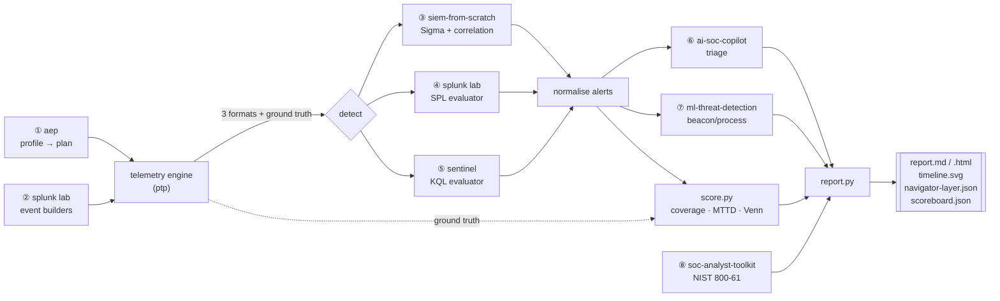

# Purple Team Pipeline

**One command runs an adversary emulation from the ATT&CK plan to the incident report across an entire detection portfolio - and measures what was caught, what was missed, and how fast.**

     

> **Authorized emulation on synthetic telemetry only.** No exploit code, payloads or operational attack instructions exist anywhere in this repo. Every technique is represented by the *telemetry a defender would expect to observe*, and all data is generated locally. Scope: the owner's own lab systems - see the sibling repos' `SCOPE.md`.

```bash
# clone the siblings (skip if they already sit next to this repo), then:
python -m ptp run --profile ransomware-affiliate --env hospital --out runs/demo
```

That single command plans a ransomware-affiliate intrusion against a synthetic
hospital network, generates the telemetry three different SIEMs ingest, runs the
owner's **real** detection content from three separate repositories over it,
triages the alerts, scores coverage and mean-time-to-detect against hidden
ground truth, and writes a Purple Team Exercise Report with an ATT&CK Navigator
layer - in about 45 seconds.

## The scoreboard (real output, committed under `examples/`)

Ransomware-affiliate profile, 30 ATT&CK techniques, synthetic regional-hospital environment:

| | Coverage | Techniques detected | Mean MTTD |
|---|---|---|---|
| **mini-SIEM** (Sigma + correlation) | 23.3% | 7 / 30 | 23.7 s |
| **Splunk** (SPL + TA-threat-detection) | 33.3% | 10 / 30 | 6.0 s |
| **Sentinel** (KQL-subset evaluator) | 20.0% | 6 / 30 | 0.3 s |
| **Combined** | **43.3%** | **13 / 30** | **4.6 s** |

- **3** techniques were caught by **all three** stacks (defence in depth); **17** were missed by every stack.
- **6** false positives on an equivalent benign-only run (mini-SIEM 3, Splunk 0, Sentinel 3).
- Coverage by tactic: persistence, defense-evasion and command-and-control **100%**; **discovery, collection and impact 0%** - the actionable finding.

Which stack caught what (Venn-style):

| Caught by | # | Steps |
|---|---|---|
| all three | 3 | T1059.001 PowerShell, T1070.001 Clear Logs, T1110.003 Spray |
| mini-SIEM + Splunk | 2 | T1003.001 LSASS, T1071.001 Web C2 |
| mini-SIEM + Sentinel | 1 | T1078 Valid Accounts |
| Sentinel + Splunk | 1 | T1053.005 Scheduled Task |
| Splunk only | 4 | T1021.001 RDP, T1021.002 SMB, T1105 Ingress Tool, T1041 Exfil-over-C2 |
| mini-SIEM only | 1 | T1543.003 Windows Service |
| Sentinel only | 1 | T1562.001 Impair Defenses |
| **missed** | **17** | spearphish, Kerberoasting, discovery, collection, pass-the-hash, impact … |

Full artefacts: [`examples/ransomware-affiliate-hospital/`](examples/ransomware-affiliate-hospital/) -
[`report.md`](examples/ransomware-affiliate-hospital/report.md),
[`report.html`](examples/ransomware-affiliate-hospital/report.html),
[`navigator-layer.json`](examples/ransomware-affiliate-hospital/navigator-layer.json),
[`scoreboard.json`](examples/ransomware-affiliate-hospital/scoreboard.json),
[`timeline.svg`](examples/ransomware-affiliate-hospital/timeline.svg).

## Why this project exists

I built six security tools - a purple-team planner, three SIEM rule-sets, a SOC
copilot, an ML detector and an analyst toolkit. Each one works on its own. The
question a hiring manager actually has is whether they work **together**, and
whether I can answer "what would we catch if this actor hit us?" with a measured
number instead of a shrug. This is that capstone: it drives all of them from one
command and turns the portfolio into a single, honest coverage metric. It is
deliberately **not** a seventh detection tool - it imports the real repos and
re-implements none of them, so every number on the scoreboard is produced by
detection content that lives, and is tested, elsewhere.

## What it demonstrates

- **Systems integration**, not reimplementation: seven sibling repos resolved at
  runtime (`PORTFOLIO_ROOT` or `vendor/`) and imported; a clear failure that
  lists what is missing if one is absent (`python -m ptp doctor`).
- **Threat-informed defence**: the exercise starts from an adversary profile and
  an ATT&CK plan (from `ai-adversary-emulation-planner`), so it tests what an
  actor *does*, not what the rules happen to cover.
- **A telemetry engine** that turns each plan step into realistic synthetic
  events in every format the sibling SIEMs ingest - Windows Security + Sysmon
  JSON (mini-SIEM schema *and* Splunk TA sourcetypes), Linux auth.log, Zeek
  conn, firewall - with benign background noise, and keeps per-event **ground
  truth** in a separate file the detectors never see.
- **Three detection stacks over identical telemetry**, normalised to one alert
  schema, so coverage is a fair comparison and collection blind spots show up as
  data.
- **Measurement that a SOC lead recognises**: per-step detected/missed, **MTTD
  per step**, coverage % per tactic and per stack, a which-stack-caught-what
  table, false positives measured on benign noise, and an ATT&CK Navigator layer
  coloured detected / partial / missed.
- **An end-to-end report**: Markdown + self-contained HTML, a hand-written SVG
  kill-chain timeline (no dependencies), and a NIST SP 800-61 incident narrative
  rendered by `soc-analyst-toolkit`.

| Feature | CompTIA Security+ (SY0-701) | MITRE ATT&CK | NIST CSF 2.0 |
|---|---|---|---|
| End-to-end purple-team loop (plan → emulate → detect → measure → report) | 4.4 Security alerting and monitoring; 4.8 Incident response | whole kill chain (T1566.001 … T1486) | IDENTIFY (ID.RA), DETECT (DE.AE, DE.CM) |
| Telemetry engine across 5 log formats | 4.4 Log aggregation / data sources; 3.3 Secure infrastructure (logging) | per-technique data sources | DETECT (DE.CM) |
| Three detection stacks, normalised alerts | 4.4 SIEM, correlation, alert tuning | T1110.003, T1059.001, T1003.001, T1021.001/.002, T1071.001, T1070.001 | DETECT (DE.CM, DE.AE) |
| Coverage %, MTTD, per-tactic gaps | 4.4 Monitoring coverage; 5.2 Risk management; 5.4 Metrics | coverage across all 14 tactics | IDENTIFY (ID.RA), DETECT |
| False-positive baseline on benign noise | 4.4 Alert tuning, false positives | - | DETECT (DE.AE), RESPOND (RS.AN) |
| ML scoring (beacon / process) | 4.4 ML-assisted detection | T1071.001 beaconing, T1059.001 | DETECT (DE.AE) |
| Alert triage, human-in-the-loop | 4.8 Incident response (analysis); 4.7 Automation | - | RESPOND (RS.AN, RS.CO) |
| ATT&CK Navigator layer + NIST 800-61 report | 4.8 IR process; 5.1 Reporting | scored matrix | RESPOND, RECOVER (RC.IM) |

## Architecture



The seven repos integrated: `ai-adversary-emulation-planner`,
`splunk-threat-detection-lab`, `siem-from-scratch`,
`microsoft-sentinel-detection-engineering`, `ai-soc-copilot`,
`ml-threat-detection`, `soc-analyst-toolkit`. More in
[`docs/architecture.md`](docs/architecture.md).

## Quickstart

```bash
git clone https://github.com/brooklynkid707-cmd/purple-team-pipeline.git
cd purple-team-pipeline
pip install --break-system-packages -r requirements.txt

# Siblings: if the other portfolio repos sit next to this one, nothing to do.
# Otherwise point at them or clone them into vendor/:
export PORTFOLIO_ROOT=/path/to/portfolio        # option A
make setup                                       # option B (git clone into vendor/)
python -m ptp doctor                             # verify all 7 resolve

# Run the whole exercise end to end (~45s):
make demo
# or:
python -m ptp run --profile ransomware-affiliate --env hospital --out runs/demo
```

Other commands:

```bash
python -m ptp profiles                           # list adversary profiles (from aep)
python -m ptp replay examples/ransomware-affiliate-hospital
python -m ptp compare runs/before runs/after     # diff coverage after writing a rule
python -m pytest -q                               # 38 tests
```

## Sample output

```text
$ python -m ptp run --profile ransomware-affiliate --env hospital --out runs/demo
[1/6] planning  profile=ransomware-affiliate env=hospital
      30 techniques across 12 phases
[2/6] telemetry engine  (synthetic events + benign noise + ground truth)
      emitted 20282 events; ground truth for 30 steps
[3/6] detection  (mini-SIEM Sigma+correlation / Splunk SPL / Sentinel KQL)
      minisiem   19 alerts from 37 rules
      splunk     28 alerts from 25 rules
      sentinel    9 alerts from 13 rules
      false-positive baseline: re-running stacks on benign-only telemetry
[4/6] triage  (ai-soc-copilot) + ML scoring (ml-threat-detection)
      copilot verdicts: 56; ml detectors: beacon*, process*
[5/6] scoring  (coverage, MTTD, Venn, Navigator layer)
[6/6] report  (Markdown + HTML + SVG timeline + NIST 800-61 incident report)

  coverage 43.3%  (13/30 techniques)   mean MTTD 5s   FP 6
  report:  runs/demo/report.md
  html:    runs/demo/report.html
```

```text
$ python -m ptp replay examples/ransomware-affiliate-hospital
  step  tactic                 technique    status    stacks
  S04   execution              T1059.001    detected  minisiem, sentinel, splunk
  S11   defense-evasion        T1070.001    detected  minisiem, sentinel, splunk
  S12   credential-access      T1003.001    detected  minisiem, splunk
  S14   credential-access      T1110.003    detected  minisiem, sentinel, splunk
  S16   discovery              T1018        missed    -
  S24   command-and-control    T1071.001    detected  minisiem, splunk
  S30   impact                 T1486        missed    -
  ...
  by stack: minisiem=23.3%  splunk=33.3%  sentinel=20.0%
```

The ML detectors add signal the signatures miss: the beacon detector scores the
60-second C2 beacon at **0.91**, and the process detector flags the
WINWORD→PowerShell encoded command at **0.85**. The copilot triaged all 56
alerts (severity + technique) with every verdict queued for human review.

## Project layout

```text
purple-team-pipeline/
├── ptp/
│   ├── siblings.py          runtime resolver/importer for the 7 sibling repos
│   ├── scenario.py          aep profile + env -> phased plan -> ordered steps
│   ├── telemetry/
│   │   ├── inventory.py      synthetic hospital hosts/users/addresses
│   │   ├── builders.py       facade over the splunk-lab event builders (+ extra IDs)
│   │   ├── emitters.py       technique -> expected telemetry (detection fixtures)
│   │   ├── formats.py        one event -> Splunk / mini-SIEM / Sentinel wire formats
│   │   └── engine.py         plan -> events + benign noise + ground_truth.jsonl
│   ├── detect/
│   │   ├── normalize.py      one alert schema (stack, rule, technique, ts, entities)
│   │   └── runner.py         adapters: minisiem run | splunk harness | sentinel simulate
│   ├── triage/
│   │   ├── copilot_triage.py normalised alerts -> ai-soc-copilot verdicts
│   │   └── mltd_scoring.py   telemetry -> ml-threat-detection beacon/process scores
│   ├── score.py             join to ground truth: coverage, MTTD, Venn, Navigator
│   ├── report.py            Markdown + HTML + SVG timeline + soctk incident report
│   ├── pipeline.py          end-to-end orchestration
│   └── cli.py               run | replay | compare | doctor | profiles
├── scripts/
│   ├── setup_siblings.sh    git clone the 7 repos into vendor/
│   └── record_demo.py       animated SVG of the six stages (no deps)
├── docs/                    architecture, methodology, extending, for-hiring-managers
├── examples/ransomware-affiliate-hospital/   one real run's committed outputs
├── tests/                   38 pytest tests (siblings, telemetry, detection, score, report, cli)
├── Makefile  requirements.txt  LICENSE  pytest.ini  docs/integration-contract.md
```

## How detection and scoring work

**Ground truth is split from the logs.** Each plan step emits log lines (no
labels) *and* a `ground_truth.jsonl` row (step id, technique, timestamp). The
stacks see only the logs; the scorer joins their alerts to the ground truth. A
detector cannot read a label, so coverage is real. `tests/test_telemetry.py`
asserts no label string ever appears in a log file.

**One event, three formats.** The emitters produce Splunk-lab records; a single
converter renders each into mini-SIEM JSON / auth.log / iptables / Zeek and into
Sentinel `SecurityEvent` rows. Where a stack has no parser or table for an event
(mini-SIEM has none for event ID 4769; Sentinel has no Sysmon table), the event
is simply absent for that stack - and that collection gap is what the per-stack
coverage measures.

**Matching and MTTD.** An alert covers a step when it shares the step's technique
(exact, or a bare parent against its sub-technique - siblings never cross-credit)
*and* fires inside the step's time window. MTTD = first covering alert − step
start, clamped to ≥ 0; stateful correlation rules carry real accumulation
latency, signature rules are ~0. Full definitions, and the honest caveats about
binned scheduled searches and synthetic timing, are in
[`docs/methodology.md`](docs/methodology.md).

**False positives** are measured the rigorous way: re-run the same stacks over a
benign-only telemetry set and count what fires. Alerts on attack telemetry whose
technique tag falls outside the plan are reported separately as *unattributed*
(real detections with tag drift), never counted as FPs.

## Honest limitations

- **Synthetic telemetry.** No real endpoint, EDR or packet capture. Emitters
  render the telemetry a technique *would* produce; they execute nothing. No
  payloads or exploit code anywhere.
- **Evaluator subsets.** The Splunk and Sentinel stacks are the siblings'
  subset-of-SPL / subset-of-KQL evaluators. Sentinel runs ~13 of 28 rules
  (the rest use KQL operators the evaluator does not support) and ingests only
  `SecurityEvent` here, so identity/Office/cloud rules cannot fire. The report
  always states which stacks ran.
- **Per-technique, not per-procedure** coverage; one technique = one step.
- **Absolute numbers are lab figures.** MTTD measures detection-logic latency,
  not ingestion/scheduler delay. The *relative* findings (which tactics are
  blind, which stack is strongest where, which rules to write next) are what
  transfer. [`docs/for-hiring-managers.md`](docs/for-hiring-managers.md) reads
  the numbers the way a SOC lead would.

## What I learned / Next steps

**Learned**

- Integration is the hard part and the valuable part: the bugs were never in the
  detections, they were in making three tools agree on *when* an event happened
  and *which step* an alert belonged to. Splitting ground truth from the logs,
  and emitting one alert per firing instance rather than per rule, were the two
  decisions that made the scoreboard honest.
- Strict matching is what makes coverage mean something - letting a
  `T1021.001` detection credit a `T1021.002` step, or an out-of-window tag match
  credit the wrong step, inflated coverage until I stopped it.
- The cross-environment ML drift (a detector calibrated on one baseline
  over-firing on another) is a real detection-engineering lesson I surfaced in
  the report rather than tuning away.

**Next steps**

- Pull deployed-rule inventories straight from the detection repos so the plan's
  coverage analysis and this run's observed coverage can be diffed
  (expected-vs-observed Navigator layers).
- Add an identity/cloud telemetry format so Sentinel's SigninLogs/Office rules
  can participate.
- A GitHub Action that runs the pipeline on every rule change and comments the
  coverage delta on the PR.

---

JP Scirica — CompTIA Security+ | linkedin.com/in/jp-scirica
