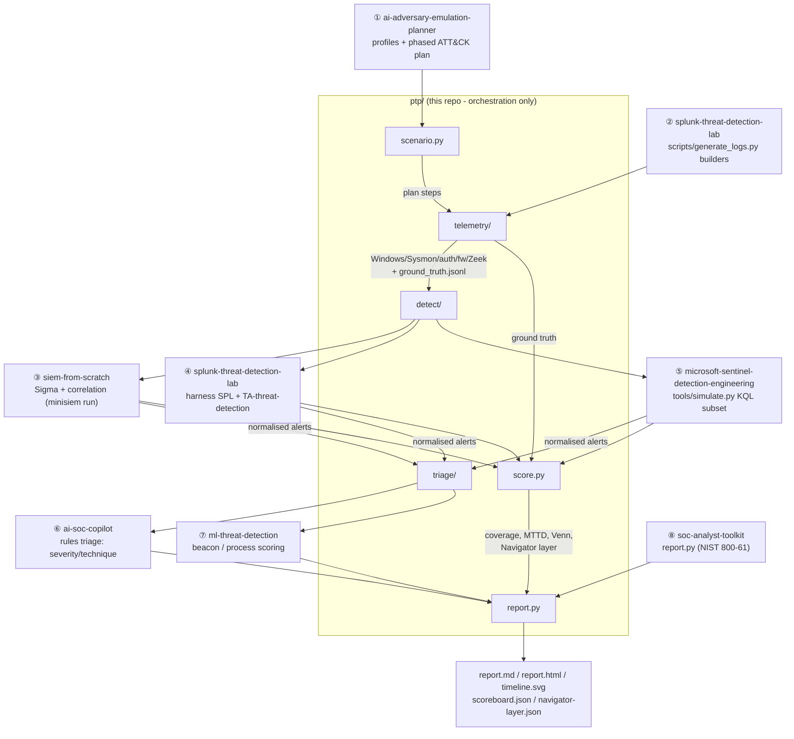

# Architecture

The Purple Team Pipeline is an **orchestrator**. It owns no detection logic and
no SIEM of its own; it drives seven sibling repositories through one flow and
measures the result. Each stage is a thin adapter over a real sibling package,
resolved at runtime by [`ptp/siblings.py`](../ptp/siblings.py) (via
`PORTFOLIO_ROOT` or `vendor/`) and imported, never copied.

(The report also calls `soc-analyst-toolkit` to render the NIST SP 800-61
incident narrative, so eight sibling touch-points in total across the seven
detection/analysis repos plus the planner.)

## Data flow and the trust boundary

The key design decision is the **ground-truth split**. The telemetry engine
emits two things from each plan step:

1. **Log lines** in the formats the SIEMs ingest - written under
   `telemetry/splunk/`, `telemetry/minisiem/`, `telemetry/sentinel/`. These
   carry *no* labels.
2. A **`ground_truth.jsonl`** row per emitted event (step id, technique,
   timestamp, format) - written separately and never mixed into the logs.

The detection stacks only ever see (1). The scorer joins their alerts back to
(2). A detector therefore cannot "cheat" by reading a label, and the scoreboard
measures real detection, not bookkeeping. (`tests/test_telemetry.py` asserts the
labels never appear in any log file.)

## One event, three wire formats

To compare three SIEMs fairly they must see the *same events*. The emitters
produce the Splunk lab's `Record` objects (ISO-timestamped key=value / pipe
lines); [`telemetry/formats.py`](../ptp/telemetry/formats.py) is the single
place that converts each record into the other stacks' formats:

| Source event | Splunk | mini-SIEM | Sentinel |
|---|---|---|---|
| Windows Security (4624/4625/4688/4720/4732/1102/7045) | verbatim line | ECS-ish JSON | `SecurityEvent` row |
| Windows (4698/4719/4648/4776/4769) | verbatim line | *(no parser)* | `SecurityEvent` row |
| Sysmon 1/3/11/22 | verbatim line | ECS-ish JSON | *(no table)* |
| Sysmon 7/10 | verbatim line | *(no parser)* | *(no table)* |
| Linux auth.log | verbatim line | auth.log | *(no table)* |
| Firewall (pipe) | verbatim line | iptables + Zeek conn | *(no table)* |

The blank cells are not bugs - they are **collection gaps** the scoreboard
measures as per-stack coverage. mini-SIEM has no parser for 4769, so it can
never catch Kerberoasting here; Sentinel has no Sysmon table, so it misses the
SMB fan-out. That asymmetry is exactly what a purple-team exercise exposes.

## Why orchestration, not reimplementation

Every number in the report is produced by the owner's actual detection content:
the Sigma rules and correlation engine from `siem-from-scratch`, the
`savedsearches.conf` SPL run through the `splunk-threat-detection-lab` harness,
and the analytics-rule KQL run through the Sentinel `simulate.py` evaluator. If
a rule changes in a sibling repo, the next pipeline run reflects it. That is the
whole point - this repo proves the parts work **together**.
