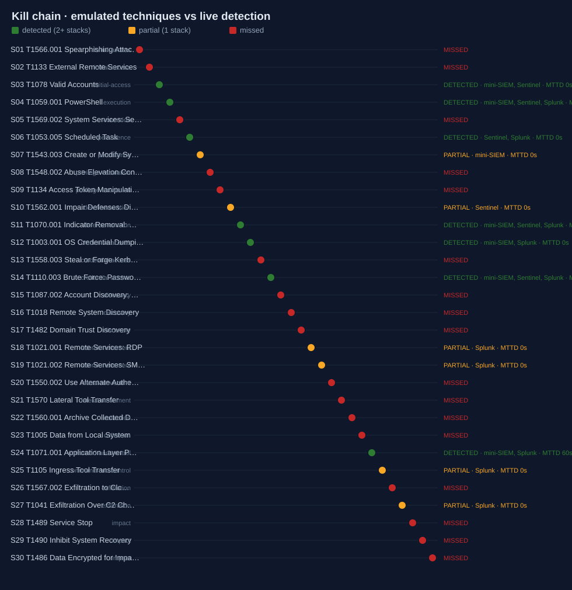

# Purple Team Exercise Report

**Exercise:** Purple-team emulation - Group A - Ransomware Affiliate (healthcare/finance)  
**Adversary profile:** `ransomware-affiliate`  
**Environment:** Regional Hospital - clinical and corporate IT (lab)  
**Generated:** 2026-10-23 18:20 UTC  
**Detection stacks run:** mini-SIEM, Splunk, Sentinel

> Authorized emulation on synthetic telemetry. No exploit code or payloads are used; every technique is represented by the telemetry a defender would expect to observe.

## Executive summary

- **13 of 30 emulated techniques were detected (43.3% coverage).**
- Mean time to detect (MTTD) across detected steps: **5s** (median 0s).
- Defence in depth: **3** techniques were caught by all three stacks; **17** were missed by every stack.
- False positives on an equivalent benign-only run: **6** (mini-SIEM 3, Splunk 0, Sentinel 3).

## Coverage by detection stack

| Stack | Techniques detected | Coverage | Mean MTTD |
|---|---|---|---|
| mini-SIEM | 7/30 | 23.3% | 24s |
| Splunk | 10/30 | 33.3% | 6s |
| Sentinel | 6/30 | 20.0% | 0s |
| **Combined** | **13/30** | **43.3%** | **5s** |

## Which stack caught what

| Membership | # | Steps |
|---|---|---|
| none (missed) | 17 | S01, S02, S05, S08, S09, S13, S15, S16, S17, S20, S21, S22, S23, S26, S28, S29, S30 |
| mini-SIEM | 1 | S07 |
| mini-SIEM + Sentinel | 1 | S03 |
| mini-SIEM + Sentinel + Splunk | 3 | S04, S11, S14 |
| mini-SIEM + Splunk | 2 | S12, S24 |
| Sentinel | 1 | S10 |
| Sentinel + Splunk | 1 | S06 |
| Splunk | 4 | S18, S19, S25, S27 |

## Kill-chain timeline

| Step | Tactic | Technique | Status | Stacks | MTTD |
|---|---|---|---|---|---|
| S01 | initial-access | T1566.001 Spearphishing Attachment | MISSED | - | - |
| S02 | initial-access | T1133 External Remote Services | MISSED | - | - |
| S03 | initial-access | T1078 Valid Accounts | DETECTED | mini-SIEM, Sentinel | 0s |
| S04 | execution | T1059.001 PowerShell | DETECTED | mini-SIEM, Sentinel, Splunk | 0s |
| S05 | execution | T1569.002 System Services: Service Execution | MISSED | - | - |
| S06 | persistence | T1053.005 Scheduled Task | DETECTED | Sentinel, Splunk | 0s |
| S07 | persistence | T1543.003 Create or Modify System Process: Windows Service | PARTIAL | mini-SIEM | 0s |
| S08 | privilege-escalation | T1548.002 Abuse Elevation Control: Bypass UAC | MISSED | - | - |
| S09 | privilege-escalation | T1134 Access Token Manipulation | MISSED | - | - |
| S10 | defense-evasion | T1562.001 Impair Defenses: Disable or Modify Tools | PARTIAL | Sentinel | 0s |
| S11 | defense-evasion | T1070.001 Indicator Removal: Clear Windows Event Logs | DETECTED | mini-SIEM, Sentinel, Splunk | 0s |
| S12 | credential-access | T1003.001 OS Credential Dumping: LSASS Memory | DETECTED | mini-SIEM, Splunk | 0s |
| S13 | credential-access | T1558.003 Steal or Forge Kerberos Tickets: Kerberoasting | MISSED | - | - |
| S14 | credential-access | T1110.003 Brute Force: Password Spraying | DETECTED | mini-SIEM, Sentinel, Splunk | 0s |
| S15 | discovery | T1087.002 Account Discovery: Domain Account | MISSED | - | - |
| S16 | discovery | T1018 Remote System Discovery | MISSED | - | - |
| S17 | discovery | T1482 Domain Trust Discovery | MISSED | - | - |
| S18 | lateral-movement | T1021.001 Remote Services: RDP | PARTIAL | Splunk | 0s |
| S19 | lateral-movement | T1021.002 Remote Services: SMB/Windows Admin Shares | PARTIAL | Splunk | 0s |
| S20 | lateral-movement | T1550.002 Use Alternate Authentication Material: Pass the Hash | MISSED | - | - |
| S21 | lateral-movement | T1570 Lateral Tool Transfer | MISSED | - | - |
| S22 | collection | T1560.001 Archive Collected Data: Archive via Utility | MISSED | - | - |
| S23 | collection | T1005 Data from Local System | MISSED | - | - |
| S24 | command-and-control | T1071.001 Application Layer Protocol: Web Protocols | DETECTED | mini-SIEM, Splunk | 1m 00s |
| S25 | command-and-control | T1105 Ingress Tool Transfer | PARTIAL | Splunk | 0s |
| S26 | exfiltration | T1567.002 Exfiltration to Cloud Storage | MISSED | - | - |
| S27 | exfiltration | T1041 Exfiltration Over C2 Channel | PARTIAL | Splunk | 0s |
| S28 | impact | T1489 Service Stop | MISSED | - | - |
| S29 | impact | T1490 Inhibit System Recovery | MISSED | - | - |
| S30 | impact | T1486 Data Encrypted for Impact | MISSED | - | - |

## Coverage by ATT&CK tactic

| Tactic | Detected / total | Coverage |
|---|---|---|
| initial-access | 1/3 | `########----------------` 33.3% |
| execution | 1/2 | `############------------` 50.0% |
| persistence | 2/2 | `########################` 100.0% |
| privilege-escalation | 0/2 | `------------------------` 0.0% |
| defense-evasion | 2/2 | `########################` 100.0% |
| credential-access | 2/3 | `################--------` 66.7% |
| discovery | 0/3 | `------------------------` 0.0% |
| lateral-movement | 2/4 | `############------------` 50.0% |
| collection | 0/2 | `------------------------` 0.0% |
| command-and-control | 2/2 | `########################` 100.0% |
| exfiltration | 1/2 | `############------------` 50.0% |
| impact | 0/3 | `------------------------` 0.0% |

## Gaps and recommended detections

17 techniques produced no matching alert on any stack. Recommended detections:

| Step | Technique | Recommended detection |
|---|---|---|
| S01 | T1566.001 Spearphishing Attachment | author a detection for T1566.001 (Spearphishing Attachment) over its expected telemetry |
| S02 | T1133 External Remote Services | author a detection for T1133 (External Remote Services) over its expected telemetry |
| S05 | T1569.002 System Services: Service Execution | service-install (7045) to a user-writable ImagePath |
| S08 | T1548.002 Abuse Elevation Control: Bypass UAC | Sysmon 1 high-integrity child of a known auto-elevating LOLBin (fodhelper/eventvwr) |
| S09 | T1134 Access Token Manipulation | Sysmon 1 high-integrity child of a known auto-elevating LOLBin (fodhelper/eventvwr) |
| S13 | T1558.003 Steal or Forge Kerberos Tickets: Kerberoasting | 4769 RC4 (0x17) TGS volume per account (Kerberoasting) |
| S15 | T1087.002 Account Discovery: Domain Account | process-creation rule on net/dsquery/nltest with per-host rate baselining |
| S16 | T1018 Remote System Discovery | process-creation rule on net/dsquery/nltest with per-host rate baselining |
| S17 | T1482 Domain Trust Discovery | process-creation rule on net/dsquery/nltest with per-host rate baselining |
| S20 | T1550.002 Use Alternate Authentication Material: Pass the Hash | 4624 type-3 NTLM / 5140 share-access correlation and 4648 explicit-credential fan-out |
| S21 | T1570 Lateral Tool Transfer | 4624 type-3 NTLM / 5140 share-access correlation and 4648 explicit-credential fan-out |
| S22 | T1560.001 Archive Collected Data: Archive via Utility | Sysmon 1 rule on rar/7z/wbadmin with staging-path heuristics |
| S23 | T1005 Data from Local System | Sysmon 1 rule on rar/7z/wbadmin with staging-path heuristics |
| S26 | T1567.002 Exfiltration to Cloud Storage | per-host outbound byte baseline (eventstats mean+3sigma) and CASB upload volume |
| S28 | T1489 Service Stop | Sysmon 1 rule on vssadmin/wbadmin/bcdedit and service-stop bursts before mass writes |
| S29 | T1490 Inhibit System Recovery | Sysmon 1 rule on vssadmin/wbadmin/bcdedit and service-stop bursts before mass writes |
| S30 | T1486 Data Encrypted for Impact | Sysmon 1 rule on vssadmin/wbadmin/bcdedit and service-stop bursts before mass writes |

## Machine-learning scoring (ml-threat-detection)

| Detector | Ran | Units scored | ML alerts | Note |
|---|---|---|---|---|
| beacon | yes | 21 | 1 | - |
| process | yes | 690 | 1 | - |

- `beacon` score 0.9082: 10.20.5.53 -&gt; 203.0.113.66:443 shows beacon-like timing: 24 connections every ~60 s (100% regular, size CV 0.00, composite 0.91).
- `process` score 0.8514: winword.exe -&gt; powershell.exe on WS-RAD-03 is anomalous mainly because of enc flag, hidden flag and office parent shell.

## Alert triage (ai-soc-copilot, rules backend)

56 alerts triaged; the copilot's technique agreed with the detecting stack on 25/56. All verdicts are queued for human review (nothing auto-closes).

## Incident report (NIST SP 800-61)

# Incident Report PTX-2026-1023: Purple-team exercise: Purple-team emulation - Group A - Ransomware Affiliate (healthcare/finance)

| | |
| --- | --- |
| **Classification** | TLP:AMBER |
| **Severity** | HIGH |
| **Status** | Closed - exercise |
| **Incident type** | Authorized adversary emulation (purple team) |
| **Lead analyst** | JP Scirica (purple team) |
| **Detection source** | Purple Team Pipeline across mini-SIEM, Splunk and Sentinel |
| **Report generated** | 2026-10-23T18:20:31Z |

## 1. Executive summary

Emulated the ransomware-affiliate profile (30 techniques) against the Regional Hospital - clinical and corporate IT (lab) and measured detection. 13 techniques were detected (43.3% coverage), mean MTTD 5s; 17 were missed.

**Impact:** Exercise only - no production impact. Detection gaps identified on 17 techniques, concentrated in discovery, collection and impact.

**Root cause:** Detection coverage gaps, not a real intrusion. See the recommended detections.

## 2. Key times and metrics

| Milestone | Time (UTC) |
| --- | --- |
| First Activity | 2026-10-20T01:00:00Z |
| Detected | 2026-10-20T02:00:00Z |
| Contained | 2026-10-20T15:30:00Z |

| Metric | Value |
| --- | --- |
| Dwell time (first activity -> detection) | 1h 0m |
| Time to contain (detection -> containment) | 13h 30m |
| Time to recover (detection -> recovery) | n/a |

## 3. Affected assets and accounts

| Host | User | Criticality | Status |
| --- | --- | --- | --- |
| WS-RAD-03 | nrivera | high | lab replica |

## 4. Timeline of events

| Time (UTC) | Source | Event | Entity |
| --- | --- | --- | --- |
| 2026-10-20T01:00:00Z | purple-team | T1566.001 Spearphishing Attachment (missed) | S01 |
| 2026-10-20T01:30:00Z | purple-team | T1133 External Remote Services (missed) | S02 |
| 2026-10-20T02:00:00Z | purple-team | T1078 Valid Accounts (detected) | S03 |
| 2026-10-20T02:30:00Z | purple-team | T1059.001 PowerShell (detected) | S04 |
| 2026-10-20T03:00:00Z | purple-team | T1569.002 System Services: Service Execution (missed) | S05 |
| 2026-10-20T03:30:00Z | purple-team | T1053.005 Scheduled Task (detected) | S06 |
| 2026-10-20T04:00:00Z | purple-team | T1543.003 Create or Modify System Process: Windows Service (partial) | S07 |
| 2026-10-20T04:30:00Z | purple-team | T1548.002 Abuse Elevation Control: Bypass UAC (missed) | S08 |
| 2026-10-20T05:00:00Z | purple-team | T1134 Access Token Manipulation (missed) | S09 |
| 2026-10-20T05:30:00Z | purple-team | T1562.001 Impair Defenses: Disable or Modify Tools (partial) | S10 |
| 2026-10-20T06:00:00Z | purple-team | T1070.001 Indicator Removal: Clear Windows Event Logs (detected) | S11 |
| 2026-10-20T06:30:00Z | purple-team | T1003.001 OS Credential Dumping: LSASS Memory (detected) | S12 |

## 5. Indicators of compromise

All indicators are defanged. Refang with `python -m soctk ioc <file>` before blocking.

_No IOCs recorded._

## 6. MITRE ATT&CK mapping

| Tactic ID | Tactic | Technique | Name | Evidence |
| --- | --- | --- | --- | --- |
| TA0001 | Initial Access | T1566.001 | Spearphishing Attachment | no alert (gap) |
| TA0001 | Initial Access | T1133 | External Remote Services | no alert (gap) |
| TA0001 | Initial Access | T1078 | Valid Accounts | detected |
| TA0002 | Execution | T1059.001 | PowerShell | detected |
| TA0002 | Execution | T1569.002 | System Services: Service Execution | no alert (gap) |
| TA0003 | Persistence | T1053.005 | Scheduled Task | detected |
| TA0003 | Persistence | T1543.003 | Create or Modify System Process: Windows Service | detected |
| TA0004 | Privilege Escalation | T1548.002 | Abuse Elevation Control: Bypass UAC | no alert (gap) |
| TA0004 | Privilege Escalation | T1134 | Access Token Manipulation | no alert (gap) |
| TA0005 | Defense Evasion | T1562.001 | Impair Defenses: Disable or Modify Tools | detected |
| TA0005 | Defense Evasion | T1070.001 | Indicator Removal: Clear Windows Event Logs | detected |
| TA0006 | Credential Access | T1003.001 | OS Credential Dumping: LSASS Memory | detected |
| TA0006 | Credential Access | T1558.003 | Steal or Forge Kerberos Tickets: Kerberoasting | no alert (gap) |
| TA0006 | Credential Access | T1110.003 | Brute Force: Password Spraying | detected |
| TA0007 | Discovery | T1087.002 | Account Discovery: Domain Account | no alert (gap) |
| TA0007 | Discovery | T1018 | Remote System Discovery | no alert (gap) |
| TA0007 | Discovery | T1482 | Domain Trust Discovery | no alert (gap) |
| TA0008 | Lateral Movement | T1021.001 | Remote Services: RDP | detected |
| TA0008 | Lateral Movement | T1021.002 | Remote Services: SMB/Windows Admin Shares | detected |
| TA0008 | Lateral Movement | T1550.002 | Use Alternate Authentication Material: Pass the Hash | no alert (gap) |
| TA0008 | Lateral Movement | T1570 | Lateral Tool Transfer | no alert (gap) |
| TA0009 | Collection | T1560.001 | Archive Collected Data: Archive via Utility | no alert (gap) |
| TA0009 | Collection | T1005 | Data from Local System | no alert (gap) |
| TA0011 | Command and Control | T1071.001 | Application Layer Protocol: Web Protocols | detected |
| TA0011 | Command and Control | T1105 | Ingress Tool Transfer | detected |
| TA0010 | Exfiltration | T1567.002 | Exfiltration to Cloud Storage | no alert (gap) |
| TA0010 | Exfiltration | T1041 | Exfiltration Over C2 Channel | detected |
| TA0040 | Impact | T1489 | Service Stop | no alert (gap) |
| TA0040 | Impact | T1490 | Inhibit System Recovery | no alert (gap) |
| TA0040 | Impact | T1486 | Data Encrypted for Impact | no alert (gap) |

## 7. Response (NIST SP 800-61 lifecycle)

### 7.1 Detection and analysis

- 13/30 techniques detected across three stacks
- Mean MTTD 5s; 6 false positives on benign noise

### 7.2 Containment

- Exercise - no containment required

### 7.3 Eradication

- Author the recommended detections for the missed techniques

### 7.4 Recovery

- Re-run the pipeline after rule changes to confirm the gaps close

## 8. Evidence collected

- Scoreboard: 13/30 detected
- Navigator layer and timeline committed with this report

## 9. Post-incident activity

### Lessons learned

- Discovery, collection and impact tactics are the weakest (privilege-escalation 0%, discovery 0%, collection 0%)
- Stateful correlation (mini-SIEM) adds latency but catches multi-step chains signatures miss

### Recommendations

- S01 T1566.001: author a detection for T1566.001 (Spearphishing Attachment) over its expected telemetry
- S02 T1133: author a detection for T1133 (External Remote Services) over its expected telemetry
- S05 T1569.002: service-install (7045) to a user-writable ImagePath
- S08 T1548.002: Sysmon 1 high-integrity child of a known auto-elevating LOLBin (fodhelper/eventvwr)
- S09 T1134: Sysmon 1 high-integrity child of a known auto-elevating LOLBin (fodhelper/eventvwr)
- S13 T1558.003: 4769 RC4 (0x17) TGS volume per account (Kerberoasting)
- S15 T1087.002: process-creation rule on net/dsquery/nltest with per-host rate baselining
- S16 T1018: process-creation rule on net/dsquery/nltest with per-host rate baselining

---
_Generated with soctk report. Review and edit before distribution._

## Appendix - all alerts

| Stack | Rule | Techniques | Time |
|---|---|---|---|
| mini-SIEM | RDP Logon From Non-Private Address | T1021.001, T1078 | 2026-10-20T01:30:00Z |
| mini-SIEM | Encoded PowerShell Command Line | T1059.001, T1027 | 2026-10-20T02:30:00Z |
| mini-SIEM | Office Application Spawning Command Shell | T1566.001, T1204.002 | 2026-10-20T02:30:00Z |
| mini-SIEM | Suspicious Service Installed (7045) | T1543.003 | 2026-10-20T03:00:00Z |
| mini-SIEM | Windows Security Audit Log Cleared | T1070.001 | 2026-10-20T06:00:01Z |
| mini-SIEM | LSASS Memory Dump Via Procdump Or Comsvcs | T1003.001 | 2026-10-20T06:30:07Z |
| mini-SIEM | Password Spraying - One Source, Many Accounts | T1110.003 | 2026-10-20T07:31:38Z |
| mini-SIEM | Windows Logon Brute Force (threshold) | T1110.001 | 2026-10-20T07:32:06Z |
| mini-SIEM | New User Account Created (4720) | T1136.001 | 2026-10-20T09:12:00Z |
| mini-SIEM | DNS Query For Threat-Intel Listed Domain | T1071.004, T1568 | 2026-10-20T12:30:00Z |
| mini-SIEM | Network Connection To Threat-Intel Listed IP | T1071, T1102 | 2026-10-20T12:31:00Z |
| mini-SIEM | Network Connection To Threat-Intel Listed IP | T1071, T1102 | 2026-10-20T12:36:00Z |
| mini-SIEM | Network Connection To Threat-Intel Listed IP | T1071, T1102 | 2026-10-20T12:41:00Z |
| mini-SIEM | Periodic Outbound Connections (beaconing) | T1071.001, T1573 | 2026-10-20T12:42:00Z |
| mini-SIEM | Network Connection To Threat-Intel Listed IP | T1071, T1102 | 2026-10-20T12:46:00Z |
| mini-SIEM | Network Connection To Threat-Intel Listed IP | T1071, T1102 | 2026-10-20T12:51:00Z |
| mini-SIEM | Periodic Outbound Connections (beaconing) | T1071.001, T1573 | 2026-10-20T12:54:00Z |
| mini-SIEM | DNS Query For Threat-Intel Listed Domain | T1071.004, T1568 | 2026-10-20T13:00:00Z |
| mini-SIEM | New User Account Created (4720) | T1136.001 | 2026-10-20T13:12:00Z |
| Splunk | Windows Password Spraying - One Source, Many Accounts | T1110.003 | 2026-10-20T07:30:00Z |
| Splunk | Lateral Movement - RDP To Multiple Hosts By One User | T1021.001 | 2026-10-20T09:00:00Z |
| Splunk | Lateral Movement - SMB Fan-Out From One Host | T1021.002 | 2026-10-20T08:30:00Z |
| Splunk | Lateral Movement - SMB Fan-Out From One Host | T1021.002 | 2026-10-20T10:00:00Z |
| Splunk | PowerShell Encoded Command | T1059.001, T1027.010 | 2026-10-20T02:30:00Z |
| Splunk | PowerShell Encoded Command | T1059.001, T1027.010 | 2026-10-20T02:30:00Z |
| Splunk | Scheduled Task Created By Interactive User | T1053.005 | 2026-10-20T03:30:00Z |
| Splunk | Scheduled Task Created By Interactive User | T1053.005 | 2026-10-20T03:30:01Z |
| Splunk | Beaconing - Regular Interval Outbound Connections | T1071.001, T1571 | 2026-10-20T12:32:00Z |
| Splunk | Office Application Spawning Shell Or Script Host | T1566.001, T1204.002 | 2026-10-20T02:30:00Z |
| Splunk | Rare Parent-Child Process Pair | T1059, T1218 | - |
| Splunk | Rare Parent-Child Process Pair | T1059, T1218 | - |
| Splunk | Rare Parent-Child Process Pair | T1059, T1218 | - |
| Splunk | Rare Parent-Child Process Pair | T1059, T1218 | - |
| Splunk | Rare Parent-Child Process Pair | T1059, T1218 | - |
| Splunk | Rare Parent-Child Process Pair | T1059, T1218 | - |
| Splunk | Rare Parent-Child Process Pair | T1059, T1218 | - |
| Splunk | Rare Parent-Child Process Pair | T1059, T1218 | - |
| Splunk | Rare Parent-Child Process Pair | T1059, T1218 | - |
| Splunk | Rare Parent-Child Process Pair | T1059, T1218 | - |
| Splunk | Rare Parent-Child Process Pair | T1059, T1218 | - |
| Splunk | LSASS Memory Access By Non-Allowlisted Process | T1003.001 | 2026-10-20T06:30:00Z |
| Splunk | Windows Event Log Cleared | T1070.001 | 2026-10-20T06:00:00Z |
| Splunk | Windows Event Log Cleared | T1070.001 | 2026-10-20T06:00:01Z |
| Splunk | Connection To Known-Bad IP (Threat Intel Match) | T1071, T1105 | 2026-10-20T12:31:00Z |
| Splunk | Connection To Known-Bad IP (Threat Intel Match) | T1071, T1105 | 2026-10-20T14:00:00Z |
| Splunk | Data Exfiltration - Outbound Volume Spike Per Host | T1048, T1041 | 2026-10-20T13:00:00Z |
| Splunk | DNS Query From Scripting Or LOLBin Process | T1071.004, T1218 | 2026-10-20T12:30:00Z |
| Sentinel | Windows - Security event log cleared (1102) | T1070, T1070.001 | 2026-10-20T06:00:01Z |
| Sentinel | Windows - Brute force logon attempts from a single source IP (4625) | T1110, T1110.001 | 2026-10-20T07:00:00Z |
| Sentinel | Windows - Explicit credential use against many hosts (4648 fan-out) | T1021, T1021.002, T1078.002 | 2026-10-20T02:00:00Z |
| Sentinel | Windows - Encoded or download-cradle PowerShell command line (4688) | T1059.001, T1027 | 2026-10-20T02:30:00Z |
| Sentinel | Windows - Scheduled task created with suspicious action (4698) | T1053, T1053.005 | 2026-10-20T03:30:01Z |
| Sentinel | Windows - System audit policy changed (4719) | T1562, T1562.002 | 2026-10-20T05:30:00Z |
| Sentinel | Windows - User account created on a server (4720) | T1136, T1136.001 | 2026-10-20T09:12:00Z |
| Sentinel | Windows - User account created on a server (4720) | T1136, T1136.001 | 2026-10-20T13:12:00Z |
| Sentinel | Windows - NTLM password spray from one workstation (4776) | T1110, T1110.003 | 2026-10-20T07:30:00Z |

### Unattributed alerts (fired on attack telemetry, technique tag outside the plan)

- mini-SIEM: Windows Logon Brute Force (threshold) (T1110.001)
- mini-SIEM: New User Account Created (4720) (T1136.001)
- mini-SIEM: DNS Query For Threat-Intel Listed Domain (T1071.004, T1568)
- mini-SIEM: DNS Query For Threat-Intel Listed Domain (T1071.004, T1568)
- mini-SIEM: New User Account Created (4720) (T1136.001)
- Splunk: DNS Query From Scripting Or LOLBin Process (T1071.004, T1218)
- Sentinel: Windows - User account created on a server (4720) (T1136, T1136.001)
- Sentinel: Windows - User account created on a server (4720) (T1136, T1136.001)

---

JP Scirica - CompTIA Security+ | linkedin.com/in/jp-scirica